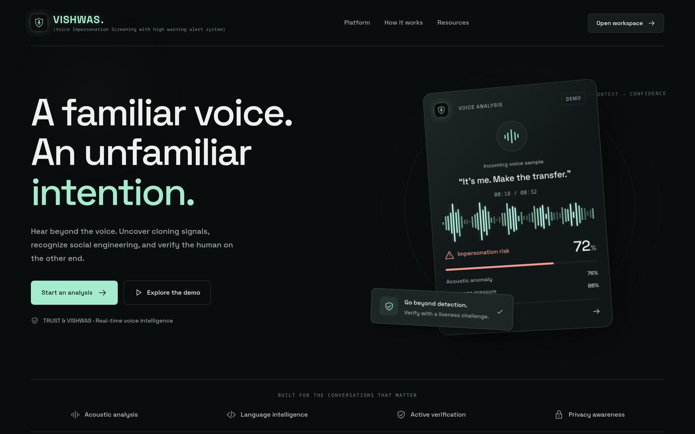
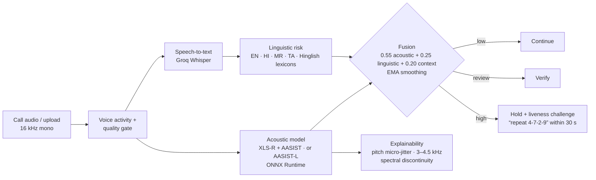
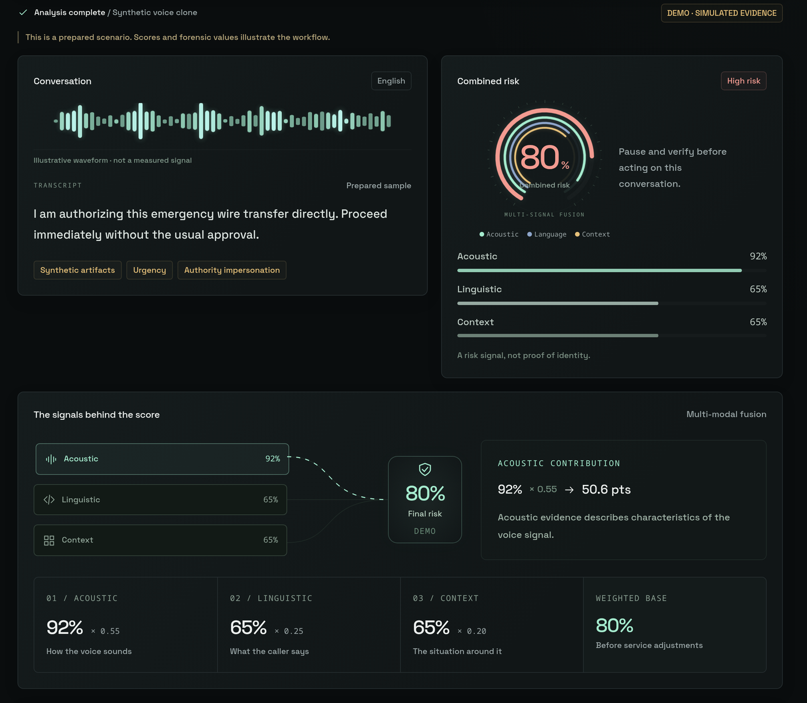
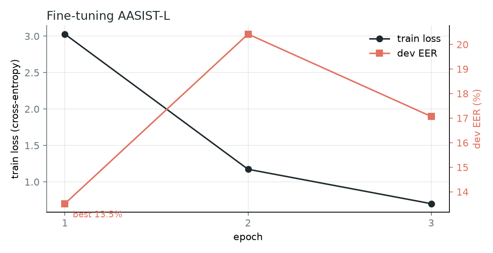

<div align="center">

# VoiceGuard · TRUST & VISHWAS

**Real-time voice-impersonation screening for Indian languages.**
Detects AI-cloned voices, flags social-engineering language, and asks the caller to prove they are live.



</div>

---

## Why

A cloned voice now costs a few seconds of audio and a free TTS account. The scams that follow, such as an "urgent transfer" from the CEO or a "KYC update" from the bank, rarely arrive in clean studio English. They come in Hindi, Hinglish, Marathi and Tamil, over a phone line. VoiceGuard scores **how** something is said, **what** is said, and **whether a live human is on the line**, and keeps those signals separate so a reviewer can see why a call was flagged.

## How it works



| Signal | What it measures | Status |
|---|---|---|
| **Acoustic** | Spoof probability from a fine-tuned anti-spoofing network over 4.04 s windows (up to 8 windows per clip, 50% overlap, mean-aggregated) | Trained model |
| **Linguistic** | Urgency, secrecy, authority-impersonation and credential-harvesting cues in the transcript, in 4 languages + Hinglish | Working |
| **Context** | Session-level risk prior | Working |
| **Liveness challenge** | Random 4-digit spoken challenge, 30 s expiry, response latency (clone pipelines lag), transcript match + acoustic re-check | Working |
| **Explainability** | Pitch micro-jitter and spectral discontinuity, reported next to the score | Working |
| Speaker consistency, prosody, VAD | ECAPA embeddings, F0/pause statistics, Silero VAD | Placeholders (roadmap) |



---

## The model

The acoustic signal comes from a model **fine-tuned in this repo** and served as a single ONNX file with a fixed contract (`waveform float32[batch, 64600]` in, `spoof_logit float32[batch]` out). The backend therefore never changes when the model does. Two models implement that contract:

| | **AASIST-L** (edge) | **XLS-R + AASIST** (accuracy) |
|---|---|---|
| Base | Official [ClovaAI AASIST-L](https://github.com/clovaai/aasist), pre-trained on ASVspoof 2019 LA | [`facebook/wav2vec2-xls-r-300m`](https://huggingface.co/facebook/wav2vec2-xls-r-300m), self-supervised on 436K h in 128 languages |
| Input | raw waveform → sinc-conv filterbank | raw waveform → CNN encoder → 24 transformer layers |
| Fine-tuned | **all 85,306 parameters**: 14 Conv2d, 45 Linear and 18 BatchNorm layers, 4 graph-attention layers | **top 8 of 24 transformer layers** + learned weights over all 25 hidden states + a new AASIST graph back-end (~100M trainable); CNN and layers 0-15 frozen |
| Optimiser | Adam 1e-4, cosine to 5e-6, weight decay 1e-4, grad-clip 5 | Adam: 1e-4 head / 1e-5 encoder, cosine, grad-clip 5 |
| Size | 0.8 MB ONNX | ~1.2 GB ONNX |
| Runs on | phone, laptop CPU | server CPU / GPU |

### Training data and splits

`training/scripts/prepare_data.sh` builds one manifest from five sources, all downloaded from Hugging Face:

| Source | Contributes | Languages |
|---|---|---|
| [garystafford/deepfake-audio-detection](https://huggingface.co/datasets/garystafford/deepfake-audio-detection) | 933 real + 933 fake from 6 commercial TTS systems (ElevenLabs, Amazon Polly, Speechify, Kokoro, Hume, LuvVoice) | English |
| [In-the-Wild](https://huggingface.co/datasets/mueller91/In-The-Wild) | real-world celebrity speech and deepfakes (37.9 h) | English |
| [IndicVoices](https://huggingface.co/datasets/ai4bharat/IndicVoices) | bona-fide spontaneous speech | Hindi, Marathi, Tamil, Bengali |
| [MLAAD](https://huggingface.co/datasets/mueller91/MLAAD) | deepfakes from 9 Hindi TTS systems (IndicF5, Veena, XTTS v2, Bark…) | Hindi |
| Vocoder re-synthesis of held-out IndicVoices speakers | same-channel Indic spoof (Griffin-Lim, mel-Griffin-Lim, phase reset) | Indic |

The split logic prevents the usual ways an anti-spoofing EER gets inflated:

* **Speaker-disjoint.** No speaker appears in more than one split, so the model can't recognise voices instead of artefacts.
* **Generator holdout.** Entire TTS systems are kept out of training. Dev uses ElevenLabs (+ Veena); test uses Speechify, Kokoro, In-the-Wild's unknown generators (+ IndicF5). **The headline number is always on synthesisers the model has never seen.**
* **Balanced sampling** by (label × language), so "English" and "spoof" never become correlated within a batch.
* **Label-neutral augmentation.** Telephony narrowband round trip, MUSAN-style noise at 5-20 dB SNR, room impulse responses and gain are applied with equal probability to both classes, so the augmentation itself can't become a feature.

### Results so far

Held-out **test** split: 3,733 clips (1,810 genuine, 1,923 spoof) in English, Hindi, Bengali, Marathi and Tamil. Every spoof comes from a generator **unseen in training**: Speechify, Kokoro, IndicF5 (Hindi) and In-the-Wild's unknown deepfake tools.

| Model | Trained on | Test EER ↓ | ROC-AUC ↑ |
|---|---|---:|---:|
| AASIST-L, original ASVspoof 2019 weights (no fine-tuning) | none | 43.4% | n/a |
| AASIST-L, fine-tuned (laptop CPU, 454-clip English test) | 1,108 English clips | 25.3% | 0.844 |
| **XLS-R 300M + AASIST, top 8 of 24 layers fine-tuned** (Colab T4, 27 min) | 6,646 clips, all 5 sources | **2.97%** | **0.996** |

XLS-R + AASIST on the test split, broken down:

| Slice | Clips | EER | Clones missed (FNR) |
|---|---:|---:|---:|
| English | 3,255 | 3.54% | 0.2% |
| Hindi | 203 | 0.99% | 0.0% |
| Unseen TTS (Speechify, Kokoro, IndicF5) | 378 | n/a | 0.0% |
| In-the-Wild deepfakes | 1,545 | n/a | 0.3% |

* **Run:** 101M of 316M parameters trainable (XLS-R layers 16-23, the layer-weighting head and the AASIST back-end). fp16 mixed precision, balanced (label × language) sampling. Dev EER was best (9.04%) at epoch 5, and training stopped early after epoch 9.
* **Thresholds:** the dev threshold is conservative on test. At that threshold it misses 0.2% of clones but flags 13.8% of genuine clips, almost all of them noisy In-the-Wild recordings (18.1% flagged, against 2.4% on clean sources). The dev split is small (1,185 clips), so recalibrating the threshold on a larger dev set is the next step.
* **Language coverage:** Bengali, Marathi and Tamil only have genuine clips in test (false-positive rate 0%, 4.3% and 1.2%), so the model's behaviour on clones in those languages is not measured yet.

The full corpus and the larger model took the error on unseen generators from 25.3% to 2.97%. The two numbers come from different test sets, so treat this as a direction rather than an exact ratio.

<p align="center"></p>

The first CPU run of AASIST-L, on 1.1k clips: train loss keeps falling, but dev EER is best at epoch 1, a sign the model was memorising its three training TTS systems. That is why the GPU run uses the full corpus and keeps generator holdout strict.

### What "fine-tuned all layers" actually means

`training/scripts/inspect_finetune.py` checks each block of the network: is it trainable, does a real loss produce a usable gradient there, and how far did its weights move from the pretrained checkpoint. For AASIST-L:

| Block group | Params | Receives gradient | Weight change |
|---|---:|---:|---:|
| Residual encoder (6 blocks) | 50,792 | 50,520 | 1.3–1.7% |
| Spectral + temporal GAT | 3,744 | 3,744 | 1.3–1.5% |
| Heterogeneous GAT (4 layers) | 29,664 | 21,728 | 2.6–3.1% |
| Graph pooling, positional, master nodes, first BN | 784 | 784 | 0.2–3.8% |
| Output layer | 322 | 322 | 6.3% |
| **Total** | **85,306** | **77,098 (90.4%)** | |

Two findings came out of this:

1. **The attention weights of all four heterogeneous graph-attention layers never train.** They sit behind a softmax at temperature 100 and a saturated `tanh`, so with the pretrained weights their gradients are ~1e-43, below what Adam can turn into an update. After fine-tuning they are bit-identical to the checkpoint. That's 7,936 parameters, effectively frozen.
2. **Five `BatchNorm` layers are dead code upstream.** `Residual_block.forward` computes `bn1(x)` and then overwrites it with `conv1(x)`, so 272 parameters are never used.

The XLS-R back-end re-implements the residual encoder without that bug, and its tests assert that every trainable parameter receives a gradient.

---

## Quickstart

### Backend (FastAPI + ONNX Runtime)

```bash
cd backend
uv sync --extra dev
cp .env.example .env            # MODEL_BACKEND=aasist-l-onnx to use the committed model
uv run uvicorn app.main:app --reload --port 8000
# http://localhost:8000/docs
uv run pytest
```

The 0.8 MB `backend/models/aasist-l-indic-v0.1.onnx` is committed, so a fresh clone serves the real model. `GET /api/v1/health` reports which inference path is live and the model file's SHA-256, so a heuristic fallback can never pass for the neural model.

| Endpoint | Purpose |
|---|---|
| `POST /api/v1/verify/file` | Score an uploaded recording (all signals + explainability) |
| `WS /ws/stream` | Stream PCM chunks, get live risk updates |
| `POST /api/v1/challenge/create` · `/challenge/verify-audio` | Liveness challenge |
| `GET /api/v1/health` · `/health/model` | Provable model status |
| `GET /api/v1/sessions` · `/alerts` · `/policy` | Session history, alerts, thresholds |

### Frontend (React + Vite)

```bash
cd frontend
npm ci
npm run dev                     # http://localhost:5173; set VITE_API_BASE_URL to reach the backend
```

Four prepared scenarios (Hinglish CEO scam, Hindi KYC fraud, genuine Indian English, synthetic clone) work without a backend.

### Training

| Where | How |
|---|---|
| **Colab / SageMaker GPU** | [`training/cloud/README.md`](training/cloud/README.md): one notebook, or one launcher command. No manual data copying |
| Laptop CPU | [`training/README.md`](training/README.md): measured memory and throughput, resumable runs |

```bash
cd training
bash scripts/prepare_data.sh                                     # all datasets → data/metadata.csv
python train_aasist_l.py --config configs/xlsr_aasist_gpu.yaml   # or aasist_l_gpu.yaml
python eval.py --ckpt outputs/xlsr_aasist/best.pt --save-scores  # EER on unseen generators
python export_onnx.py --ckpt outputs/xlsr_aasist/best.pt --out xlsr-aasist.onnx
python scripts/inspect_finetune.py --config configs/xlsr_aasist_gpu.yaml --finetuned outputs/xlsr_aasist/best.pt
```

---

## Repository layout

```text
backend/      FastAPI service: scoring, fusion, STT, challenge, explainability, Firestore
frontend/     React 19 + Vite + Motion dashboard and landing page
training/
  src/          dataset (windows, augmentation), AASIST-L adapter, XLS-R + AASIST model
  scripts/      ingest_*, build_manifest, prepare_data.sh, inspect_finetune, plot_results
  configs/      aasist_l.yaml (CPU), aasist_l_gpu.yaml, xlsr_aasist_gpu.yaml
  cloud/        Colab notebook, SageMaker launcher + entry point, step-by-step guide
  train_aasist_l.py · eval.py · export_onnx.py
docs/images/  README figures
```

## Limits worth knowing

* A risk score is **not proof of identity**. The UI says so, and the challenge step exists for that reason.
* MLAAD is CC-BY-NC-4.0. A model trained with it is for research and coursework, not a commercial product.
* The vocoded Indic clips teach vocoder artefacts, not voice cloning. Report them separately rather than as an "Indic deepfake EER".
* The dev-set threshold of the first run did not transfer to the test generators (65% of genuine clips flagged at that threshold), so calibrate thresholds on the full-corpus run before deploying.

## Team

Built by Hashim Bhagad (model training, evaluation and explainability tooling), Divyam Sanghvi (backend and integration) and Shreya Poojari (frontend).
