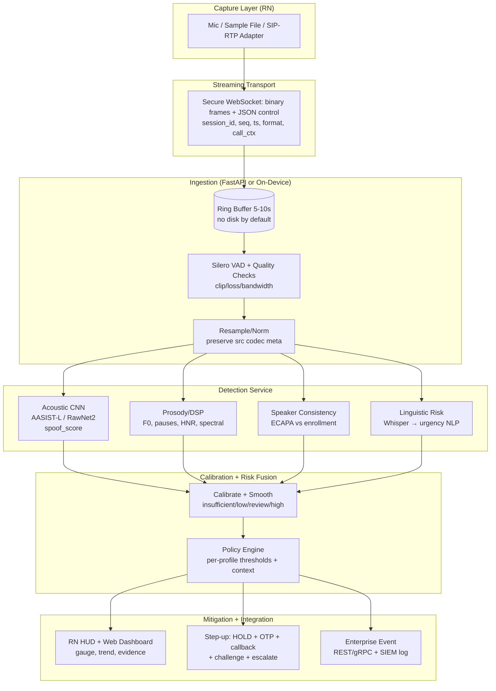
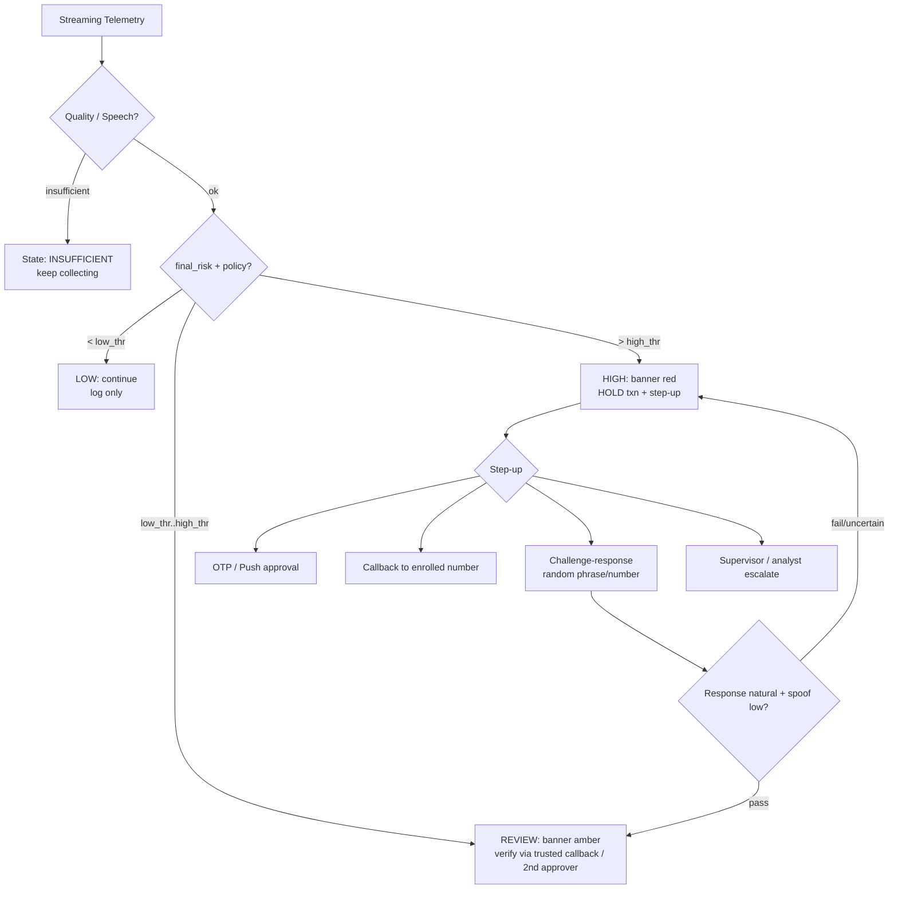

# VoiceGuard — AI-Powered Real-Time Voice Cloning Impersonation Detection
## Unified Technical Implementation Plan (SIH 2026)

**Stack:** React-Native (mobile + local inference) + FastAPI (server inference) + ONNX Runtime
**Modes:** `Local-On-Phone` (privacy-first, offline) + `Server-Assisted` (high-accuracy, telecom/enterprise)
**Status:** Implementation blueprint — merges acoustic anti-spoofing + linguistic risk + challenge-response + privacy + APIs
**One-liner:** A privacy-preserving streaming anti-spoofing service that estimates whether live voice evidence is consistent with synthetic/manipulated speech, communicates calibrated uncertainty, and triggers independent verification before a high-risk decision completes.

---

## 0. How to read this doc

* Section 1 maps **every line of the official PS** to a concrete capability + demo evidence. If it's not here, we don't build it.
* Sections 5-8 are build specs (architecture, workflows, APIs).
* Sections 9-11 are the **CNN training data + training + on-device plan** — the part judges probe deepest.
* Section 13 is hackathon scoping: Must / Should / Defer.

---

## 1. PS Requirement Traceability Matrix

| PS Requirement | Concrete System Capability | Where Implemented | Demo Evidence |
|---|---|---|---|
| Live/near-live analysis of telephony, VoIP, collaboration | Chunked streaming ingestion (20-100ms frames → 1-2s analysis windows, 250-500ms hop), WebSocket + SIP/RTP adapter interface | §5, §6.1-6.3 | Live risk trace updating 2-4x/sec on phone |
| Acoustic + spectral DL for synthesis artifacts, phase inconsistencies | Primary CNN: AASIST-L baseline → fine-tuned on codec-degraded Indic data; fallback RawNet2 | §6.4, §10 | Score separates genuine vs cloned demo pairs |
| Prosody + behavioral analysis (rhythm, pitch, pauses, microvariation) | Auxiliary DSP: F0 trajectory, pause/voiced-unvoiced stats, energy modulation, HNR/jitter-shimmer (weak signals only) | §6.5 | Evidence panel shows prosody flatness, not just a number |
| Cross-session consistency vs historical genuine samples | Speaker-consistency module: ECAPA-TDNN embeddings, cosine vs enrolled profile, kept separate from spoof score | §6.6 | Demo: same text, enrolled CXO vs clone → identity mismatch flag |
| Dynamic impersonation risk score | Calibrated + smoothed `decision_risk` with `insufficient-evidence` state, not raw softmax | §6.8 | Gauge + trend line, no flicker |
| Threshold alerting configurable per risk scenario | Policy engine: `low / review / high` thresholds per profile (`standard`, `high-value-txn`, `privileged-access`) | §7 | Change threshold in UI → different action |
| Contextual enrichment (call origin, known contact, txn context, fraud indicators) | Context-risk input: caller ID match, contact-book match, txn amount, first-time payee, fraud-list flag | §6.8, §7 | Demo txn ₹10L to new payee escalates faster than ₹500 |
| Multi-channel alerts (UI, SMS/email, in-app) | Alert bus: in-app banner + push + SMS/email mock + analyst dashboard event | §7.3, §8 | Banner + log + mock SMS on high risk |
| Pre-transaction warning + secondary verification | Step-up: transaction HOLD + OTP/push approval + callback to trusted number + supervisor escalation | §7 | High risk blocks "Approve" until OTP/callback |
| Configurable workflows for bank/enterprise/govt | Policy profiles + versioned event schema, no direct money movement in prototype | §8.3 | Show 2 profiles switching behavior |
| Minimal retention, on-device/edge, anonymization/feature-only logging | RAM-only ring buffer (5-10s), feature/event logs only, Local Mode = zero audio leaves phone, DPDP Act 2023 notice+consent | §9 | Toggle privacy mode, prove no .wav on disk |
| REST/gRPC APIs + SDKs for banking, contact-center, telecom | WebSocket stream + REST batch + gRPC-compatible event + RN SDK wrapper + OpenAPI | §8 | Live OpenAPI docs + mock bank client |
| Multilingual + Indian accents/dialects | Genuine coverage: Hindi, Indian-English, Marathi, Tamil (+Bengali/Telugu if available); code-mix; per-language metrics | §9, §10 | Per-language FPR/FNR table, Indic clone demo |
| Reusable security layer, cyber-resilience | Versioned models/policies, audit events, SIEM-ready JSON | §8.3, §12 | Exported event log |

---

## 2. Threat Model and Detection Scope

### 2.1 Attack classes (must be distinguished — different acoustics, different controls)

| Attack | Description | Detector Role | Control that catches residual risk |
|---|---|---|---|
| TTS cloning | Text + short reference → cloned voice of target | Primary: vocoder / spectral-temporal artifacts | Step-up + independent authorization |
| Real-time voice conversion | Attacker speaks, model converts timbre live | Harder: distribution shift, biological structure remains | Dynamic challenge + callback / out-of-band confirm. **Latency alone is NOT evidence.** |
| Replay | Prior genuine recording replayed | Room/device cues, unreliable alone | Liveness challenge + transaction binding (same phrase ≠ proof) |
| Partial / inserted deepfake | Real call + short fake "yes, transfer now" at critical moment | Sliding-window spike + event timeline | Re-confirm specifically the sensitive instruction |
| Human-assisted social engineering (no synth) | Real human + leaked info / coercion | Correctly stays low-risk | Contextual fraud controls: dual approval, callback, least privilege |

### 2.2 What we will NOT claim

1. Not an identity oracle. Spoof detection (bona-fide vs manipulated) ≠ speaker verification (is this CXO?). We run both, report separately.
2. No "100% deepfake detection", no "zero false positives", no "phase errors always prove fake". All vocoders/codecs/microphones change artifacts.
3. No "language-agnostic therefore unbiased". Accent/channel/speaker shortcuts must be measured per-group.
4. Challenge-response is **step-up cost, not proof**. Live VC + human accomplice can pass it. Never gate solely on it. Must pair with OTP/callback and be localizable/accessible with non-voice fallback.

---

## 3. How Voice Cloning Works (why we need multi-view)

1. **Speaker representation:** reference clip → speaker encoder → embedding (d-vector/x-vector/latent). Captures timbre, not waveform.
2. **Acoustic/token generation:** text/phonemes + embedding → Mel spectrogram or neural codec tokens (autoregressive / diffusion / NAR).
3. **Waveform reconstruction:** neural vocoder → waveform. Mel lacks phase; upsampling/reconstruction leaves statistical regularities. Detector learns these from data, not one hand-rule.
4. **Voice conversion:** live speech in → preserve content, transform identity/pitch/formants. Retains some human structure → harder than clean TTS. Hence eval must include VC, not just TTS reading.

Implication: single MFCC threshold fails. Need spectro-temporal CNN + prosody + speaker + linguistic + context.

---

## 4. Tech Stack Decision: Why React-Native + FastAPI + ONNX

| Layer | Choice | Why | Alternative rejected |
|---|---|---|---|
| Mobile app + on-device inference | **React-Native (Expo) + ONNX Runtime Mobile / sherpa-onnx** | One codebase for Android/iOS; direct mic access; offline Local Mode = strongest privacy story for PS; easy demo on judges' phones without mirroring | Flutter desktop/web (Doc-1) — good HUD but no phone-local story; React Vite web-only (Doc-2) — no on-device, no telecom path |
| Analyst / bank dashboard | **React (Vite) web, shared TS types with RN** | Large waveform + trend + event timeline better on desktop; Recharts | RN-only — cramped for SOC view |
| Backend | **FastAPI + WebSocket + REST** | Native Python audio/ML, binary+JSON WS, auto OpenAPI, team familiarity | Node backend — ML friction |
| Acoustic CNN | **AASIST-L primary, RawNet2 fallback** | AASIST explicitly models spectro-temporal spoof artifacts; AASIST-L 85K params fits phone; RawNet raw-waveform alternative if telephony-tuned checkpoint verified | WavLM/XLS-R as primary — too heavy for streams; use as offline teacher only |
| VAD | **Silero VAD** | Low-latency speech gate + quality signal | WebRTC VAD — weaker on Indic noise |
| STT | **Whisper tiny/base (server: base, phone: tiny quantized) + multilingual** | Handles Hindi/English/code-mix; tiny runs on-device | Large STT — latency killer |
| Linguistic risk | **Rules + lightweight classifier (Indic + English urgency lexicons + mBERT/MuRIL-tiny later)** | Demoable Day 2, upgradable; covers "transfer now / don't tell anyone / CEO pressure" in multiple languages | English-only keywords — fails PS multilingual |
| Speaker consistency | **ECAPA-TDNN (SpeechBrain) embeddings** | Small, robust, cosine compare vs enrollment | Joint spoof+ASV single model — conflates two tasks |
| Storage (demo) | **SQLite local + Firestore (scores/transcripts/metadata only, no raw audio)** | Auditable session log for judges | Store .wav centrally — violates privacy claim |
| Model exchange | **ONNX + INT8 quantization** | One export serves server (ONNX Runtime) + phone (ORT Mobile) | Raw PyTorch — not shippable on phone |

### Dual-mode principle

```
┌──────────────────────────────────────────────────────────────┐
│ React-Native App                                             │
│  ┌──────────────┐   ┌──────────────────┐                      │
│  │ LOCAL MODE   │   │ SERVER MODE      │                      │
│  │ VAD→AASIST-L │   │ stream frames via│──WebSocket──▶ FastAPI│
│  │ +tiny Whisper│   │ WS, score returns│◀──telemetry──        │
│  │ on-device,   │   │ (higher accuracy)│                      │
│  │ zero egress  │   └──────────────────┘                      │
│  └──────────────┘                                            │
│  Same score schema, same thresholds, toggle in UI            │
└──────────────────────────────────────────────────────────────┘
```

---

## 5. End-to-End Architecture



### 5.1 Five logical planes

1. **Capture:** RN `expo-av` / native audio, 16kHz mono float32 canonical, timestamped. Production adapter: SIP signaling + RTP/SRTP media → internal frames. Browser mic ≠ telecom — never conflate.
2. **Streaming:** `WSS` binary frames (20-100ms) + JSON control. Fields: `session_id, seq, capture_ts, sample_rate, channels, codec_hint, lang_hint, call_id, policy_profile`. Server replies: `seq, server_ts, vad, quality, risk_state, component_scores, action, model/policy versions`.
3. **Buffering/windows:** client frames 20-100ms; detector aggregates overlapping windows **1.0-2.0s, hop 250-500ms, max buffer 5-10s**. Report `time-to-first-score` separately from inference ms. 500ms window = responsive but unstable — benchmark.
4. **Preprocessing (explicit, reproducible):** validate channels/width/rate/endianness/clipping/gaps → mono (when appropriate) → resample to model rate → amplitude norm (preserve codec cues) → retain original codec meta. 16kHz resample does NOT restore 8kHz G.711 loss (8kHz/8-bit PCM). Train/test on degradation, not just upsample at inference.
5. **Decision/mitigation/integration:** §7-§8.

---

## 6. Detection Engine Design

### 6.1 Streaming contract (v1, frozen Day 1 so UI builds on mock)

```json
// Client → Server: init
{"type":"init","session_id":"uuid","sample_rate":16000,"channels":1,"codec_hint":"opus/g711/unknown","lang_hint":"hi|en|mr|ta|auto","call_id":"opt","policy_profile":"standard|high-value-txn|privileged-access"}
// Client → Server: frame (binary) + {"type":"frame","seq":123,"capture_ts":169000}
// Server → Client: telemetry @ 2-4 Hz
{"seq":123,"server_ts":169001,"vad":true,"quality":"ok|noisy|low-band|insufficient","spoof_score":0.82,"speaker_match_score":0.31,"prosody_flag":"flat|normal|unknown","linguistic_score":0.74,"transcript_delta":"transfer immediately...","context_risk":0.6,"final_risk":0.81,"state":"low|review|high|insufficient","action":"continue|verify|hold|challenge","model_ver":"aasist-l-indic-v0.1","policy_ver":"p1"}
```

REST batch `/verify/file` returns same schema + segment events. gRPC/REST enterprise event: `verification_required | transaction_hold_recommended` — never moves money in prototype.

### 6.2 VAD + quality gates

* Silero VAD as compute gate + evidence-quality signal. Benchmark on Indic noise, not assumed.
* If silence / severe loss / <1s speech → `insufficient`, do NOT score. Never label VAD as "human proof".

### 6.3 Windows (initial, must benchmark on demo laptop + target phones)

| Param | Initial | Reason |
|---|---|---|
| Transport frame | 20-100ms | Responsive network |
| Analysis window | 1.0-2.0s | Enough context for CNN + prosody |
| Hop | 250-500ms | 2-4 updates/sec, balances compute |
| Max buffered | 5-10s | Bounded memory |
| Silence | mark insufficient | Avoid scoring line noise as spoof |

### 6.4 Primary learned detector: Acoustic CNN

**Order: (1) AASIST-L baseline → (2) codec-degraded eval → (3) RawNet2 compare → (4) WavLM/XLS-R only if gain justifies latency.**

* **AASIST / AASIST-L:** graph-attention over spectro-temporal views. AASIST-L ~85K params — phone-friendly. Use official `clovaai/aasist` impl + ASVspoof-compatible preprocessing. Verify checkpoint, license, preprocessing before any accuracy claim.
* **RawNet-family:** raw-waveform alternative. Only adopt if VoIP-adapted repo has verified code+weights+license+benchmark — do not trust name alone.
* **Foundation models:** offline teacher / second-stage only unless profiling proves multi-stream feasibility.

Export: PyTorch → ONNX → INT8 (dynamic for transformer/RNN-ish, static for CNN — validate). Acceptance: score ordering + calibration + per-language metrics + thresholds within tolerance; measure cold-start, steady inference, memory, concurrent streams.

### 6.5 Auxiliary DSP + prosodic measurements (supporting, never standalone reject)

| Family | Measures | Interpretation |
|---|---|---|
| Spectral | LFCC, CQCC, slope, flatness, band-energy ratios | Distributional differences; codec/mic sensitive. Compare LFCC vs CQCC empirically; no fixed "fake above X Hz" rule |
| Temporal | Energy modulation, ZCR, transient stats | Supporting; content/noise sensitive |
| Pitch/prosody | F0 mean/var/trajectory, voiced/unvoiced ratio, pause duration, speech rate | Context feature; fragile in noise/illness/emotion/age/language |
| Voice quality | HNR, jitter/shimmer where measurable | Often unstable in short/noisy phone frames — gate by quality |
| Channel/device | Clipping, packet-loss, noise floor, estimated bandwidth | Quality/calibration features, NOT spoof indicators |

> UI must label these as `measured features` vs `model attribution` vs `policy action`. Never invent "phase discontinuity detected" without computing it.

### 6.6 Speaker verification as complementary signal (covers PS cross-session check)

* Separate ECAPA-TDNN model. Enroll: 1-3 utterances of protected speaker (CXO/official) → mean embedding stored encrypted, on-device preferred.
* At runtime: cosine vs enrollment → `speaker_match_score`. Keep separate from `spoof_score`.
* Cases: correct person + replay = spoof low but identity high yet replay flag; impostor + good VC = spoof high + identity low; no enrollment = `unknown`, don't penalize.
* UI explains: "spoof evidence" vs "identity mismatch" vs "no enrollment".

### 6.7 Linguistic risk path (Doc-2 differentiator, hardened for PS)

```
Audio chunk → Whisper (server: base, phone: tiny) → transcript
  → multilingual urgency classifier:
     (a) lexicons per language (en/hi/mr/ta + Hinglish code-mix):
         urgency ("immediately/तुरंत/तात्काळ"), secrecy ("don't tell anyone/किसी को मत बताना"),
         authority ("I am CEO/main hoon..."), txn ("transfer/OTP/account/UPI/pin")
     (b) lightweight classifier (TF-IDF/logreg → MuRIL-tiny/mBERT-tiny fine-tune if time)
  → linguistic_score [0,1] + matched spans for UI highlight
```

* Start rule-based Day 2, upgrade to ML. Evaluate per-language — English-only fails judges.
* Transcript stored as text + scores only (no audio) in demo DB.

### 6.8 Risk fusion + calibration (do NOT ship raw softmax as %)

```
decision_risk = calibrated_spoof + speaker/context + policy,
subject to quality + uncertainty gates
```

Pipeline:

1. Raw CNN logit → calibrate on held-out dev (temperature scaling / isotonic) → `spoof_score`.
2. Combine with `speaker_match`, `prosody_flag`, `linguistic_score`, `context_risk` (caller-ID match, contact-book, txn amount, new payee, fraud-list) via transparent weighted/logistic gate (weights versioned, documented).
3. Smooth over time (EMA/median) without hiding spikes; preserve segment events for partial fakes.
4. Emit `state`:

| State | Meaning | Action |
|---|---|---|
| `insufficient` | <1s speech / severe loss / low quality | Keep collecting, assert nothing |
| `low` | No intervention evidence | Continue |
| `review` | Ambiguous/conflicting | Independent verification before sensitive action |
| `high` | Calibrated + policy exceeds threshold | HOLD txn, step-up, alert analyst |

Keep fields separate (`spoof_score, speaker_match_score, audio_quality, context_risk, decision_state`); single gauge for demo must retain components in telemetry.

---

## 7. Real-Time Decision and Mitigation Workflows



### 7.1 Normal / ambiguous / high-risk paths

* **Normal:** periodic telemetry, low-risk ≠ certified identity.
* **Ambiguous:** HUD `review`, require independent-channel verify (never "repeat same phrase as proof").
* **High-risk:** default = **hold sensitive action, not drop call**. Mock HOLD + OTP + escalation in demo; real bank needs auth/idempotency/audit/key-rotation (out of scope, documented).

### 7.2 Challenge-response (killer demo, honest framing)

* Trigger when `review/high`. Generate truly random phrase/number (`"repeat: 4-7-2-9-नीला"`), TTS prompt, listen, run same CNN + timing/naturalness check + transcript match.
* Pitch line: *"Raises cost of replay/pre-generated clips; live VC + human accomplice can still pass — hence OTP/callback."* Localize prompts, offer non-voice fallback for accessibility.
* Demo script: genuine → low → cloned + urgency phrase → rising curve → challenge fail → HOLD + mock SMS.

### 7.3 Alerting + UX

**RN app (victim/employee):** live waveform, risk gauge + trend, color banner (green/amber/red/grey-insufficient), transcript with urgency highlights, challenge card (phrase + listening + pass/fail/uncertain), privacy-mode toggle, HOLD/verify buttons.

**Web dashboard (analyst):** session table, per-call drill-down (score trace + segment spikes + evidence breakdown + model/policy versions + data-handling status), threshold editor per profile.

**Multi-channel bus (prototype mock):** in-app + push + SMS/email via gateway stub; all templated: *"Elevated spoof risk (0.81). Hold transfer. Verify via callback."* Never *"caller is fraudster"* — say *"evidence suggests elevated risk"* to avoid automation bias.

---

## 8. Platform and Integration APIs

### 8.1 Streaming (primary)

`WSS /stream` — init + binary frames → telemetry (see §6.1). Auth via short-lived token; TLS; `model_ver/policy_ver` in every reply.

### 8.2 Batch (investigation + regression)

`POST /verify/file` (wav/mp3 ≤60s) → same evidence schema + aggregate + segment events. Document: batch ≠ streaming quality.

### 8.3 Enterprise event (bank/contact-center/telecom)

`POST /events` emits `session_id, state, final_risk, components, recommended_action, reasons[], model/policy_ver, ts`. Consumed by mock bank client (HOLD txn demo). Production notes: authZ, idempotency keys, rate limits, audit log, SIEM JSON, key rotation — designed, not fully built in hackathon.

SDK: thin RN/TS + Python wrappers around WS+REST with retry/backoff + schema validation; OpenAPI published from FastAPI.

Telephony path (Phase-2 real): SIP for signaling, RTP/SRTP for media → adapter → internal frames. Prototype simulates via file/mic + optional SIP stub (e.g., Pipecat reference only if it saves work).

---

## 9. Privacy, Security, Compliance-by-Design (DPDP Act 2023 context — get legal review, don't claim compliance)

* **Ephemeral:** ring buffer in RAM only; no raw `.wav` to disk by default. Crash/proxy/cache/swap configured + tested to not leak.
* **Minimization:** store scores, quality, events, transcript deltas — not audio. Feature-only logging mode default in Local Mode.
* **Consent/notice:** pre-demo consent for all voice donors; on-screen "analyzing for spoof risk, retention X, who sees alerts"; no public-figure cloning; no upload to external TTS without written approval; delete donors on request.
* **Controls:** session auth, role separation (operator vs model admin), TLS in transit + encryption at rest for any retained events, auto-delete TTLs (temp frames seconds, events per policy).
* **Governance:** dataset licenses + consent status + model licenses + training provenance + version hashes logged.
* **Anti-abuse:** not a recorder/identifier; rate-limited; enrollment data on-device preferred.
* Present "zero storage" as **mode/policy**, not absolute guarantee.

---

## 10. Dataset and Resource Plan — CNN Training Data (core ask)

### 10.1 Core anti-spoofing benchmarks (grounding, not proof of telecom readiness)

* **ASVspoof 2019 LA + 2021 LA/PA/DF:** official data/keys/metadata + EER/min-tDCF scripts. 2021 overview critical: LA sensitive to encoding/transmission, PA simulated≠real, DF cross-dataset generalization poor. Confirm license/access before download/redistribution.
* Use for baseline + model comparison; then prove Indic/telecom gap separately.

### 10.2 Indian-language genuine resources (do NOT relabel as fake)

| Resource | Use | Notes |
|---|---|---|
| AI4Bharat **IndicVoices** (large multilingual) | Genuine coverage + robustness | Via HF; check license/split |
| **IndicVoices-R** (high-quality multilingual) | Eval + licensed training subset | Higher fidelity |
| **Svarah** (Indian-accented English) | Accent eval |  |
| **Lahaja** (Hindi multi-accent) | Accent eval |  |
| + Tamil/Marathi/Bengali/Telugu subsets where licensed | Language-stratified eval | Read + spontaneous/conversational |

Synthetic Indic speech must be **generated separately** — Indic TTS checkpoints only after license/lang/speaker-permission check. Ordinary multilingual TTS ≠ targeted clone of victim.

### 10.3 Synthetic + converted + replay generation for CNN

| Category | Source / Tool | Target volume (hackathon) | Notes |
|---|---|---|---|
| TTS system A (e.g., Coqui XTTS / YourTTS, open, consented) | Generate from Indic genuine transcripts | ~1000-1500 clips | Multi-speaker, multi-lang |
| TTS system B (different family, e.g., Piper / Indic-TTS checkpoint) | Held-out generator for generalization test | ~800-1200 clips | Keep generator-disjoint from train where possible |
| Voice conversion (e.g., RVC / so-vits, real-time-ish) | Convert genuine → target timbre | ~500-800 clips | Must include; TTS-only = blind to VC |
| Replay | Replay genuine through phone speaker + re-record on RN mic, varied rooms/devices | ~200-400 clips | Separate track (PA-style), device/room metadata |
| Partial inserts | Splice 1-3s synthetic into genuine at txn phrase | ~300 clips | For spike/event evaluation |
| Genuine | IndicVoices/R + Svarah/Lahaja + team consented (read + spontaneous) | ~2500-4000 clips | Balance classes; multi-channel |

**Total hackathon train:** ~3000-5000 balanced clips is reasonable — quality + independence > round number. Keep final test fixed, unseen speakers + at least one unseen generator.

### 10.4 Noise + channel augmentation (licensed MUSAN + RIR if permitted)

Transforms: resample 8k/16k, G.711/Opus encode-decode, packet-loss/frame-drop/jitter, reverb, babble/traffic, gain/clipping, mic EQ. **Sample augmentation independently per class** (never degrade genuine one way, fake another — model learns augmentation, not spoof). Log transform per clip in metadata. Build fixed degradation test set.

### 10.5 Labels + metadata per clip (required for CNN training + bias analysis)

`label (bonafide/spoof), attack_family (tts/vc/replay/partial), generator_id, language, speaker_id, speaker_split, sample_rate, codec, noise_cond, duration, consent/license, device/room (replay), augmentation_applied`

### 10.6 Split discipline

Speaker-disjoint + generator-disjoint where possible. Never randomly split same speaker/generator across train/test. Hold out final test, don't peek iteratively.

### 10.7 Coverage matrix (minimum prototype → stronger)

| Dim | Minimum | Stronger |
|---|---|---|
| Languages | Hindi, Indian-English, Marathi, Tamil | + Bengali/Telugu, code-switch Hinglish |
| Speakers | Multiple per lang, gender/age range where licensed | District/accent-stratified |
| Genuine | Read + spontaneous | Held-out speakers/channels |
| Synthetic | 2xTTS + 1xVC | Unseen generators/settings |
| Channel | Clean + 8k narrowband + 16k wideband | Real VoIP captures, varied devices |
| Env | Quiet + traffic/babble | Replay via speakers/rooms |
| Content | Commands, numbers, names, dialogue | High-risk txn phrases + code-switch |

### 10.8 Repos to inspect (verify URL/license/weights before adopting)

* `clovaai/aasist` — baseline model + training/eval structure
* `asvspoof-challenge/2021` — baselines + metrics
* `snakers4/silero-vad` — streaming VAD (benchmark on Indic)
* SpeechBrain ECAPA-TDNN — speaker embeddings
* sherpa-onnx / ONNX Runtime Mobile — on-device STT+VAD+CNN runtime
* Any "VocalGuard / RawNet3-VoIP" links from chat — search/verify activity, license, security; never trust name alone

---

## 11. Training and Adaptation Plan (Acoustic CNN)

### 11.1 Baseline (frozen first)

Frozen/lightly fine-tuned AASIST-L + ASVspoof-compatible preprocessing on small speaker-disjoint subset. Record preprocessing, window, class/generator/codec mix. Exit: reproducible baseline + config + metrics before complexity.

### 11.2 Composition

Genuine multi-lang Indic + synthetic multi-family (see §10.3). Val = unseen speakers + ≥1 unseen synthesis condition. Test = fixed, clean + degraded.

### 11.3 Objective

Cross-entropy first. t-DCF = decision-cost metric for eval/thresholding, not neural loss (unless validated surrogate). Class weighting/threshold tuning for FPR control — weighting alone doesn't fix accent bias.

### 11.4 Fine-tuning policy

Transfer, small LR. Compare: (a) frozen backbone + head, (b) partial unfreeze, (c) full fine-tune. Early-stop on val EER + per-language FPR, not just accuracy.

### 11.5 Quantization + export

Compare FP32 vs dynamic INT8 vs static INT8 on same matrix (ONNX Runtime quantization). Acceptance: ordering + calibration + per-lang + thresholds within tolerance. Measure cold-start, steady inference, memory, concurrent streams on demo laptop + 2 target phones.

### 11.6 Calibration + thresholds

Temperature/isotonic on held-out dev per channel (wideband vs narrowband separate). Pick thresholds by cost (missed fraud vs false alarm on genuine Indic caller) + per-profile (`standard` vs `high-value-txn`). Report calibration error + insufficient-rate.

---

## 12. Evaluation Plan

### 12.1 Offline (never accuracy alone)

EER, ROC-AUC/PR-AUC (PR when attacks rare), FPR/TPR @ operating threshold, t-DCF/application cost, calibration error, insufficient-rate, **per-language/accent tables**. Use official ASVspoof EER/min-tDCF tooling for benchmark comparability.

### 12.2 Streaming (full path, measured on real hardware)

Time-to-first-score, p50/p95 score-update latency, p50/p95 inference, buffering/queue delay, dropped/late frame rate, memory/stream, concurrent-stream throughput, disconnect/malformed recovery, stability on continuous genuine, detection delay on inserted fake. No "under 50ms" claim until measured — mark as target.

### 12.3 Test scenarios (final report checklist)

Genuine HI/EN/MR/TA; clean+noisy; 8k+16k; 2xTTS + 1xVC + replay + partial insert + loss/jitter + short-utterance/insufficient case.

### 12.4 Red-team (must document failures)

Unseen speakers/generators, heavy noise, aggressive compression, short/code-switched utterances, deliberate pauses, different playback devices, human-assisted dialogue. State where detector fails + which control catches it.

---

## 13. Execution Roadmap (RN + FastAPI + Local)

| Stage | Deliverable | Exit criterion |
|---|---|---|
| 0 Setup | Threat model, licenses, data inventory, hardware profile, frozen API schema (§6.1), RN+FastAPI skeletons, mock JSON so UI starts Day 1 | Team agrees what is/isn't detected |
| 1 Audio pipeline | RN capture, framing/validation, ring buffer, Silero VAD, codec fixtures, WS stream | Stable stream + quality states, measured buffering |
| 2 Baseline CNN | AASIST-L inference offline + ONNX export | Reproducible baseline + metrics |
| 3 Robustness data | Indic genuine + synthetic + augmentation, disjoint splits, metadata (§10) | No leakage, provenance logged |
| 4 Adaptation | Fine-tune + calibrate + threshold + INT8 compare + phone benchmark | Quantized meets accuracy/latency tolerance |
| 5 Risk engine | Component scores + smoothing + uncertainty + policy profiles + speaker + linguistic + context | No flicker, explicit insufficient |
| 6 Mitigation | RN HUD + web dashboard + HOLD/OTP/callback/challenge + event timeline + mock bank | High-risk changes workflow in demo |
| 7 Evaluation | Per-condition + latency + red-team report | Reproducible by another member |
| 8 Presentation | Narrative + live demo + backup video + limitations + roadmap | Jury sees depth + realism |

**Must (internal round):** controlled streaming demo (mic/file → score → HUD → step-up), Indic genuine + ≥1 Indic synthetic, HOLD workflow.
**Should:** codec/noise aug, batch endpoint, per-lang metrics, event timeline for partials, model-compare report, privacy-mode proof (no .wav written).
**Defer (pitch as roadmap):** full SIP carrier termination, live money movement, multi-tenant scale, foundation-model ensemble, national enrollment, universal lang/codec claims.

Day split suggestion (6-day): D1 setup+mock API, D2 modules isolated (Whisper + CNN + UI mock), D3 fusion+FastAPI wiring, D4 challenge+full integration, D5 polish+3 rehearsals+backup video, D6 present.

---

## 14. Functional / Non-Functional Requirements

**Functional:** chunked ingest, VAD gate, spoof+speaker+linguistic+context scoring, calibrated state machine, challenge generation/verification, HOLD/OTP/callback/escalate, multi-channel alerts, batch verify, event export, enrollment, privacy toggle, per-profile thresholds, per-language reporting.

**Non-functional / SLOs (targets, must measure):** time-to-first-score <3s after speech onset; steady telemetry 2-4Hz; p95 update <800ms server / <1200ms phone-local (report actuals); 5+ concurrent streams server demo; RAM buffer ≤10s; no raw audio persisted in privacy mode; consent + DPDP notice; quantized model <50MB phone (target); offline Local Mode works airplane-mode.

**Hardware:** demo laptop (record CPU/RAM, e.g., i5+/8GB min) + 2 Android phones (low + mid tier) for local benchmark; USB mic + phone speaker for replay test.

---

## 15. Limitations and Open Risks

* Distribution shift (new generators/codecs/mics/langs) — learned cues decay; need monitoring + recalibration, not one-time train.
* Short windows vs stability trade-off — communicate uncertainty, don't force binary per frame.
* Resampling ≠ bandwidth recovery — codec-aware train/eval mandatory.
* Prosody/biological heuristics fragile (noise, illness, emotion, disability, aging) — weak signals only.
* Challenges inaccessible/culturally awkward, bypassable by live VC/human help — always offer non-voice path.
* Automation bias (overtrust green/red) — wording + required second channel.
* Team clones prove pipeline, not production readiness — roadmap = consented pilot + independent eval + security/accessibility review + deployment-specific calibration.

---

## 16. References

* Jung et al., AASIST: Audio Anti-Spoofing using Integrated Spectro-Temporal Graph Attention Networks, arXiv:2110.01200 (incl. AASIST-L).
* ASVspoof 2021 portal + Liu et al. arXiv:2210.02437 (channel/env/compression/cross-dataset limits); official EER/min-tDCF tooling.
* FastAPI WebSockets docs (binary/text/JSON persistent endpoints).
* MDN WebRTC codecs (G.711 8kHz PCM reference).
* AI4Bharat IndicVoices / IndicVoices-R / Svarah / Lahaja + dataset portal (genuine/accent eval; separate synthetic generation).
* ONNX Runtime quantization docs (dynamic/static INT8 trade-offs, validate accuracy).
* India DPDP Act 2023, MeitY (legal context — seek counsel).
* Impl refs: `clovaai/aasist`, `asvspoof-challenge/2021`, `snakers4/silero-vad`, SpeechBrain ECAPA, sherpa-onnx, Pipecat (optional pipeline ref).

---

## Appendix A — Demo Script (60-90s killer flow)

1. Play genuine teammate Hindi sample → gauge green, transcript benign, `low`.
2. Play cloned same-voice "transfer ₹10L immediately, don't tell anyone" → spoof↑ + urgency highlight → curve rises → `review→high`.
3. Auto-trigger challenge "repeat 7-3-नीला-9" → clone replay fails/uncertain → HOLD + mock SMS/OTP + event logged.
4. Toggle Local Mode airplane-on → repeat genuine → still scores on-phone, "0 bytes uploaded".
5. Close with roadmap slide: explainability, full telecom SDK, expanded Indic tuning.
6. **Always have offline backup video.**

## Appendix B — Judge Q&A (honest lines)

* Accuracy? → "Baseline AASIST-L fine-tuned on X Indic clips, EER Y overall, FPR Z on Hindi genuine @ threshold T; needs Indic pilot before production."
* Real calls? → "Prototype on mic/file via WS; SIP/RTP adapter + telecom APIs are Phase-2 with same schema."
* Privacy? → "RAM-only, feature-only logs, Local Mode zero egress; DPDP notice+consent; legal review pending for deployment."
* Why not just classification? → "Fusion (how it sounds + what it says + who it matches) + active step-up; passive score alone doesn't stop txn."
* Novelty? → "Calibrated streaming fusion + speaker-separated reporting + phone-local option + Indic-stratified eval, not new architecture."


---

## 17. Confirmed implementation decision — AASIST-L only

**This section supersedes any earlier suggestion to compare, ship, or retain RawNet2, XLS-R, WavLM, or another acoustic detector.** VoiceGuard will deploy exactly one learned acoustic anti-spoofing model: the official **AASIST-L** architecture from `clovaai/aasist`, fine-tuned for the project’s Indic bona-fide versus spoof distribution.

* **Training:** Google Colab GPU only. Initialize from the upstream AASIST-L checkpoint, then fine-tune with the reproducible `training/` pipeline.
* **Inference:** one 16 kHz mono, raw-waveform AASIST-L ONNX model (`aasist-l-indic-v0.1.onnx`) on ONNX Runtime CPU / ONNX Runtime Mobile. No GPU is required for the laptop or phone runtime.
* **Fixed model contract:** input `waveform: float32[batch, 64600]`; output `spoof_logit: float32[batch]`, where positive values are more spoof-like. Streaming 1–2 second speech windows are zero-padded (or use the newest buffered speech) to that model window length.
* **Fine-tuning data:** use IndicVoices for speaker-disjoint bona-fide training; IndicVoices-R, Lahaja, and Svarah for bona-fide holdout coverage where licensed; consented IndicF5 samples plus a second permitted TTS family, voice conversion, replay, and partial inserts for spoof. ASVspoof supplies initialization/benchmark context, never an Indic deployment claim.
* **Required gates:** speaker-disjoint train/dev/test, a generator unseen during train in dev and test, label-neutral channel/noise/reverb augmentation, dev-set calibration/thresholding, a fixed untouched test set, and ONNX numerical/device validation.

The standalone speaker, linguistic, context, policy, and challenge modules remain independent controls. They do not introduce a second acoustic deepfake model.
